# Proyecto Lince


Aplicación móvil académica para consultar, responder y ejecutar asignaciones de servicios turísticos. Busca ordenar la información que hoy se reparte entre llamadas, mensajes y registros manuales.

**Api Avengers · Equipo 5 · Sección 3D**

## Estado del proyecto

MVP Android implementado con datos ficticios y persistencia local en el dispositivo. Permite iniciar sesión con validación de rol, consultar servicios, confirmar o rechazar asignaciones, registrar check-in/check-out, calificar servicios, gestionar disponibilidad y editar el perfil. Cuando `SUPABASE_URL` y `SUPABASE_KEY` están configurados, la app usa Supabase Auth, PostgREST y RPC con RLS; si no hay configuración, conexión o el acceso remoto no está disponible, conserva el modo local con datos ficticios. El dominio cuenta con 40 pruebas unitarias, la migración SQL con 43 comprobaciones PGlite y el APK debug compila correctamente.

Las imágenes de `docs/diseno/interfaces` son la referencia de diseño utilizada para construir las pantallas.

## Integrantes

| Integrante | Rol |
|---|---|
| Vicente Krausse | Coordinador |
| Luis Fermin | Diseñador |
| Jeremy Ibañez | Desarrollador |

Todos participan en las pruebas y documentación.

## Usuarios y funciones

- **Conductor:** consulta sus asignaciones, confirma o rechaza, registra check-in/check-out y actualiza disponibilidad y perfil.
- **Guía:** consulta sus servicios, responde asignaciones, ejecuta los servicios asignados y actualiza disponibilidad y perfil.
- **Coordinador:** consulta todos los servicios, reasigna, califica servicios completados y revisa el resumen operativo, la disponibilidad del equipo y el historial.

Una asignación tiene un **titular** y, opcionalmente, un **acompañante**. Ambos ven el servicio, pero solo el titular responde y ejecuta.

### Cuentas de prueba

Todas usan la clave `Lince123`.

| Usuario | Correo Auth | Perfil | Rol |
|---|---|---|---|
| `conductor.demo` | `conductor.demo@lince.local` | `DRV-001` | Conductor |
| `conductor2.demo` | `conductor2.demo@lince.local` | `DRV-002` | Conductor |
| `guia.demo` | `guia.demo@lince.local` | `GUI-002` | Guía |
| `coordinador.demo` | `coordinador.demo@lince.local` | `COO-003` | Coordinador |

En modo local basta con el usuario. En Supabase se debe crear cada usuario Auth con su correo y luego vincularlo a `perfiles.auth_user_id`. Los datos de ejemplo incluyen servicios activos (pendientes y confirmados) e historial (completados y rechazados), con servicios programados para el día actual.

## Reglas implementadas

- El acceso valida cuenta, clave y rol.
- Confirmar o rechazar una asignación pendiente registra autor y fecha. El rechazo exige un motivo de entre 1 y 300 caracteres.
- El check-in se habilita 15 minutos antes de la hora programada, solo para el titular, y requiere una ubicación escrita manualmente.
- El check-out finaliza el servicio: pasa de confirmada a completada y queda en el historial.
- El coordinador puede calificar un servicio completado de 1 a 5; el promedio se muestra en la ficha de la persona.
- La reasignación solo admite personas del mismo rol y con el idioma requerido por el servicio.
- La disponibilidad se bloquea con al menos 7 días de anticipación y no permite bloquear un día con un servicio asignado.
- El perfil permite editar nombre, correo, teléfono, zona e idiomas; el ID y el rol son de solo lectura.
- El acumulado considera los servicios confirmados y completados del usuario.
- La simulación de sincronización actualiza el resumen y registra la hora de la última ejecución.

## Integración con Supabase

La app usa Supabase cuando la configuración local está presente. El modo local se conserva como respaldo y para ejecutar la demo sin red. No se sincronizan cambios entre ambos modos.

### Base de datos

Aplicar en orden en el SQL Editor del proyecto o con Supabase CLI:

1. `supabase/migrations/202610190001_estructura.sql`
2. `supabase/migrations/202610190002_permisos_y_operaciones.sql`
3. `supabase/migrations/202610280001_mvp_supabase.sql`
4. `supabase/seed.sql`

La migración `202610280001_mvp_supabase.sql` es aditiva: agrega acompañante, reasignación, calificaciones, ubicación de check-in, funciones y políticas RLS sin borrar datos existentes. La publicación de cambios en la base remota requiere permisos de administración; la publishable key de la app no permite ejecutar DDL.

Para restaurar el estado demo, ejecutar `supabase/reset_demo.sql` y luego `supabase/seed.sql`. El reset elimina solo los servicios `LIN-001` a `LIN-006`, sus asignaciones, ejecuciones, calificaciones, historial, disponibilidad y sincronizaciones; conserva los perfiles y sus vínculos con Auth. El seed es repetible si se ejecuta después del reset y deja un servicio de hoy confirmado, uno rechazado, uno completado y calificado, y servicios pendientes para conductor y guía.

### Usuarios Auth

Crear en **Authentication > Users** los cuatro correos de la tabla de cuentas, con la clave `Lince123` o la que defina el equipo. Luego vincular cada perfil:

```sql
update public.perfiles p
set auth_user_id = u.id
from auth.users u
where u.email = case p.codigo
    when 'DRV-001' then 'conductor.demo@lince.local'
    when 'DRV-002' then 'conductor2.demo@lince.local'
    when 'GUI-002' then 'guia.demo@lince.local'
    when 'COO-003' then 'coordinador.demo@lince.local'
end;
```

La creación de usuarios Auth no se hace con la publishable key desde la app; se realiza en el panel de Supabase o con la Admin API usando una clave secreta que nunca se incorpora al APK.

### Configuración Android

Crear o editar `local.properties` en la raíz, sin commitearlo:

```properties
SUPABASE_URL=https://TU-PROYECTO.supabase.co
SUPABASE_KEY=sb_publishable_TU_CLAVE
```

`app/build.gradle.kts` expone ambos valores como `BuildConfig`. La app usa la publishable key con RLS; no se debe usar `service_role` ni una clave secreta en el cliente. Si faltan los valores, el login y las operaciones usan el repositorio local.

### Pruebas SQL

```bash
cd supabase/tests
npm install
npm test
```

La suite levanta PGlite, aplica las migraciones y el seed, y comprueba 43 reglas de negocio, permisos y trazabilidad.

## Identidad visual

Nombre: **Proyecto Lince**. El símbolo de lince representa atención y seguimiento; su centro alude a un punto de ruta. Se entrega en PNG transparente y SVG editable.

| Color | Claro | Oscuro | Uso |
|---|---|---|---|
| Primario | `#175873` | `#8FCEE8` | Botones y elementos activos |
| Contenedor primario | `#CFE8F3` | `#0C4A60` | Botones secundarios y chips |
| Secundario | `#1F6B58` | `#8ED8C1` | Estados confirmados y disponibles |
| Pendiente | `#8A5B00` | `#F3C56B` | Estados pendientes y en servicio |
| Error | `#B3261E` | `#FFB4AB` | Errores y rechazos |
| Fondo | `#E3EEF4` | `#0D171D` | Fondo general |
| Superficie | `#FFFFFF` | `#132128` | Tarjetas y barras |
| Texto | `#102A36` | `#E2EDF2` | Títulos y contenido |
| Texto secundario | `#41535F` | `#B7C9D2` | Apoyos y metadatos |
| Borde | `#738590` | `#8499A4` | Contornos y separadores |

La app respeta el modo claro u oscuro del sistema. Los estados usan texto e iconos además de color. La interfaz emplea tarjetas, botones redondeados, campos etiquetados y navegación inferior para conductor y guía.

## Flujo de usuario

Diagrama de actividad UML exportado como PNG:

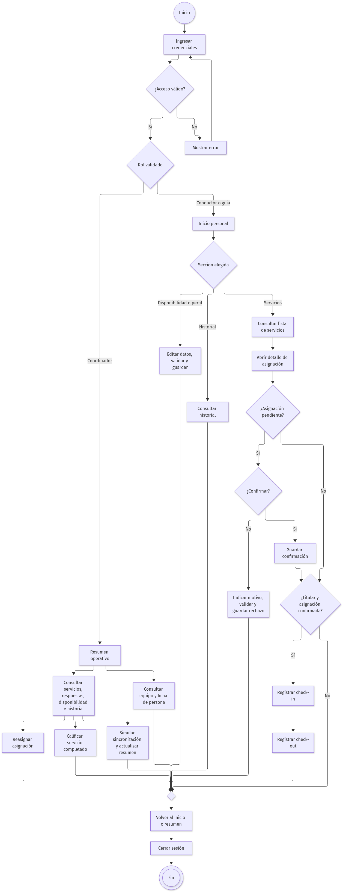

Representación equivalente en Mermaid para visualizarla directamente en GitHub. El archivo editable está en [flujo-usuario.mmd](docs/diseno/flujo-usuario.mmd).

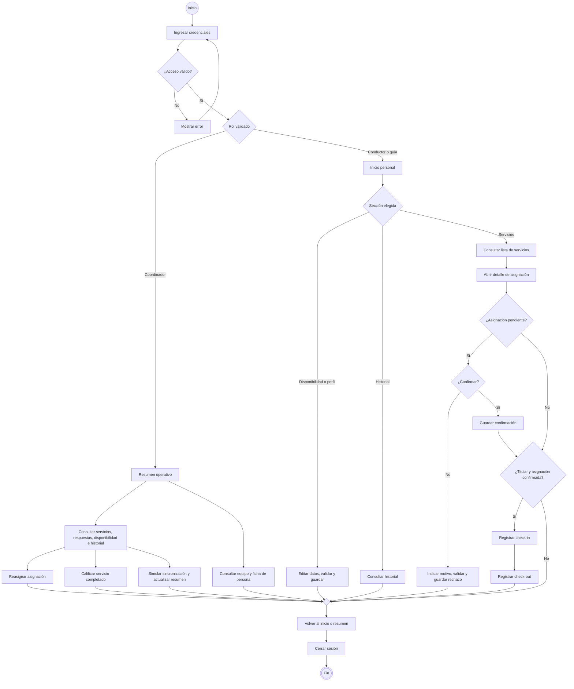

Los errores de formulario se muestran en la misma pantalla. Cada respuesta conserva usuario, fecha y hora. Una asignación rechazada no puede iniciar ejecución; el check-out se habilita después del check-in.

## Pantallas

| Pantalla | Referencia | Elementos principales |
|---|---|---|
| Inicio de sesión | [01-login.png](docs/diseno/interfaces/01-login.png) | Campos de acceso, validación de rol, cuentas de prueba |
| Inicio | [02-inicio.png](docs/diseno/interfaces/02-inicio.png) | Jornada, próximo servicio, servicios de hoy, accesos |
| Servicios | [03-servicios.png](docs/diseno/interfaces/03-servicios.png) | Búsqueda, filtros por estado, tarjetas con chips |
| Detalle | [04-detalle.png](docs/diseno/interfaces/04-detalle.png) | Información, itinerario, reserva, equipo y trazabilidad |
| Disponibilidad | [05-disponibilidad.png](docs/diseno/interfaces/05-disponibilidad.png) | Calendario mensual, selección de día, Switch y guardado |
| Perfil | [06-perfil.png](docs/diseno/interfaces/06-perfil.png) | ID de solo lectura, datos editables, idiomas, acumulado |
| Ejecución | [07-ejecucion.png](docs/diseno/interfaces/07-ejecucion.png) | Hitos, check-in con ubicación, check-out |
| Historial | [08-historial.png](docs/diseno/interfaces/08-historial.png) | Filtros, acumulado, trazabilidad y tarifas |
| Resumen de coordinación | [09-resumen-coordinacion.png](docs/diseno/interfaces/09-resumen-coordinacion.png) | Pendientes, confirmadas, rechazadas, recursos y sincronización |
| Equipo | — | Búsqueda por nombre o rol, disponibilidad, idiomas y calificación |
| Ficha de persona | — | Contacto, desempeño, acumulado y servicios activos |

Conductor y guía usan Inicio, Servicios, Agenda y Perfil en la NavigationBar. Historial se abre desde Inicio; detalle desde Servicios; ejecución desde el detalle de un servicio confirmado. Coordinación dispone de su resumen con accesos a todos los servicios, al historial y al equipo.

### Galería

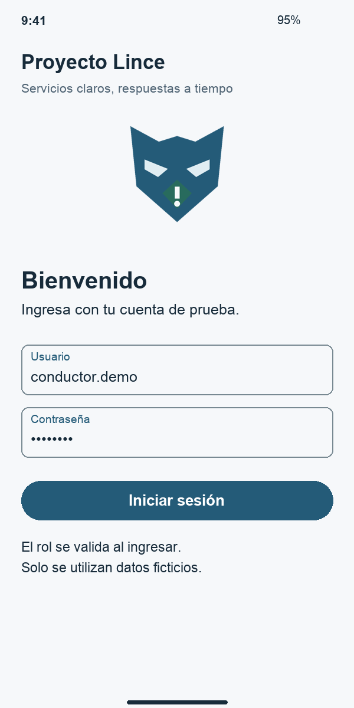

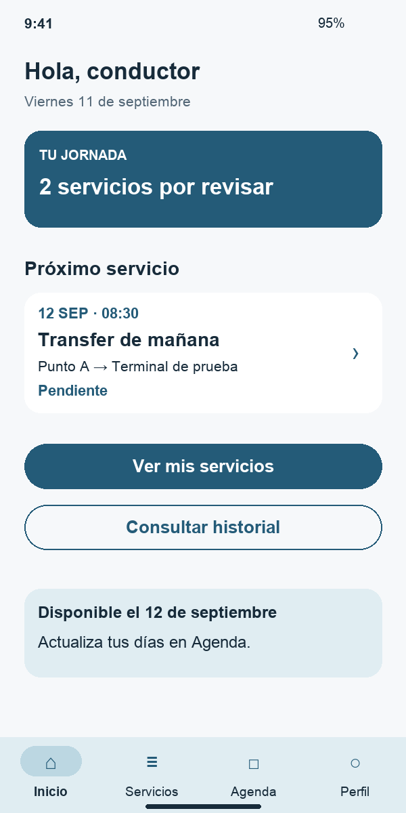

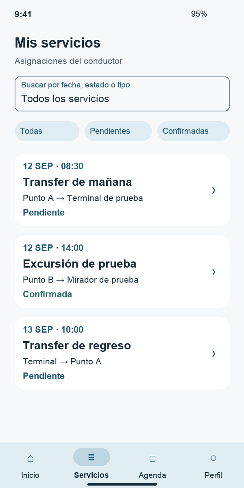

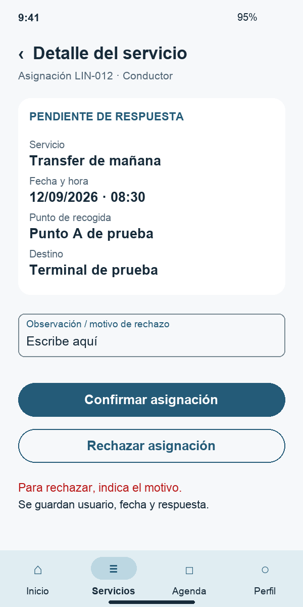

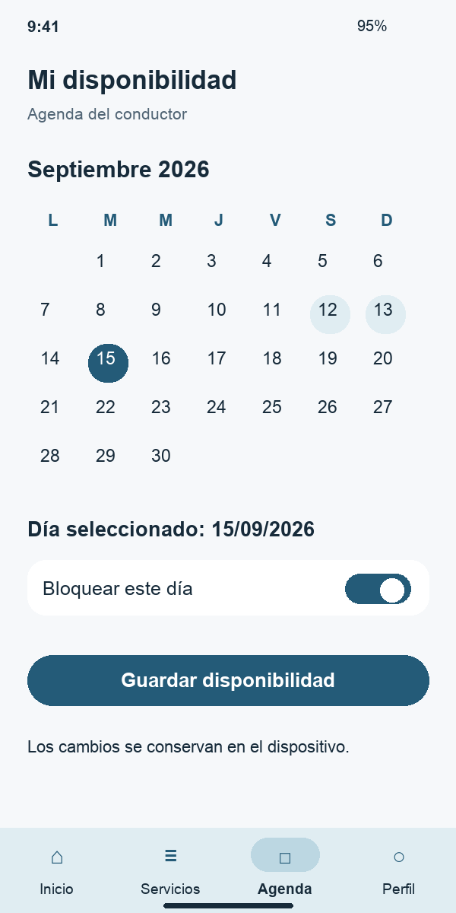

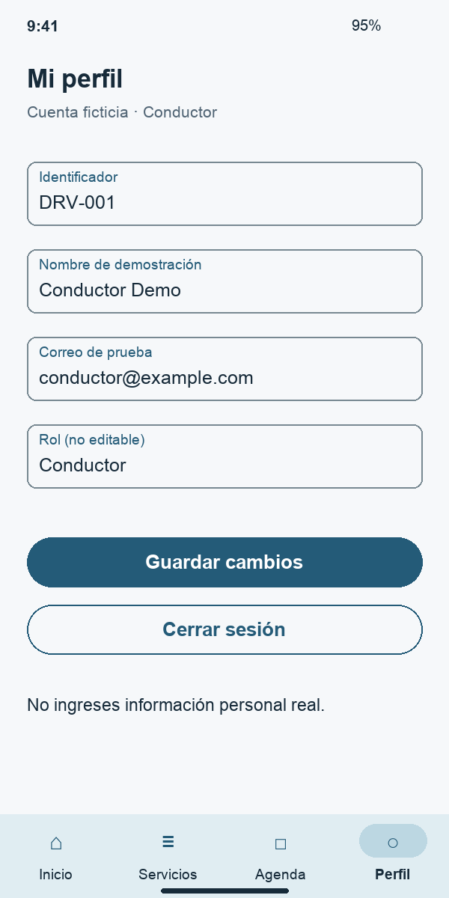

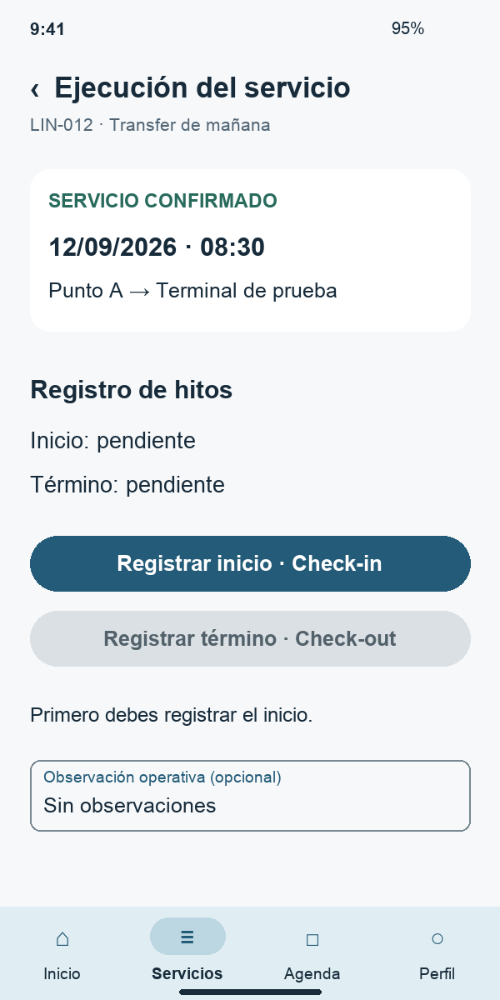

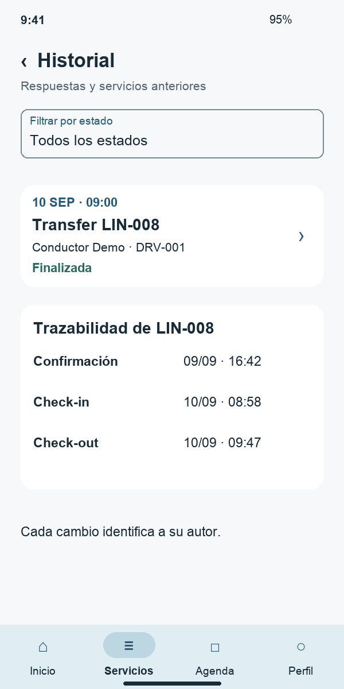

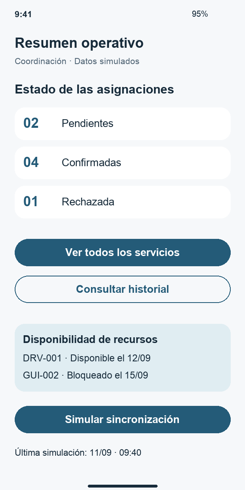

## Tecnologías

- Kotlin y Jetpack Compose con Material 3.
- Arquitectura MVVM: UI y cliente Supabase en `app/`, reglas de negocio en `dominio/`.
- Modo remoto con Supabase Auth, PostgREST, RPC y RLS; respaldo local en JSON con `AtomicFile`.
- Pruebas unitarias JUnit del dominio y pruebas SQL con PGlite.

### Compilar y probar

```bash
./gradlew :dominio:test
./gradlew :app:assembleDebug
```

En Windows:

```bat
gradlew.bat :dominio:test
gradlew.bat :app:assembleDebug
```

Requiere JDK 17 y Android SDK configurados.

Referencias oficiales de diseño: [Material Design 3](https://m3.material.io/) y [componentes Material para Android](https://developer.android.com/design/ui/mobile/guides/components/material-overview).

## Organización

```text
Proyecto-lince/
├── README.md
├── app/                      # Interfaz, navegación, ViewModels y cliente Supabase
├── dominio/                  # Modelo, repositorios y pruebas
├── supabase/                 # Migraciones, seed y pruebas PGlite
└── docs/
    ├── evidencias/
    │   ├── clase-01/
    │   │   └── Evidencia_Clase_01_MVP_Equipo05.docx
    │   └── clase-02/
    │       └── Evidencia_Clase_02_Diseno_Equipo05.docx
    └── diseno/
        ├── logo.png
        ├── logo.svg
        ├── flujo-usuario-uml.png
        ├── flujo-usuario.mmd
        └── interfaces/
            └── 01-login.png … 09-resumen-coordinacion.png
```

## Entrega de clase 2

- Documento de diseño y recursos visuales incorporados al repositorio.
- Identidad, flujo y pantallas usados como base de la implementación.
- MVP funcional con datos ficticios y persistencia local.
- Integración preparada con Supabase Auth, PostgREST, RPC y RLS, con respaldo local.
- Documentación alineada con la implementación: titular conductor o guía, acompañante opcional, equipo, ficha, reasignación y calificación.
- Pruebas unitarias del dominio, pruebas SQL PGlite y compilación del APK verificadas.
