# Proyecto Lince


Aplicación móvil académica para consultar, responder y ejecutar asignaciones de servicios turísticos. Busca ordenar la información que hoy se reparte entre llamadas, mensajes y registros manuales.

**Api Avengers · Equipo 5 · Sección 3D**

## Estado del proyecto


=======
MVP Android implementado con datos ficticios y persistencia local. Permite iniciar sesión con validación de rol, consultar servicios, confirmar o rechazar asignaciones, registrar check-in/check-out, calificar servicios, gestionar disponibilidad y editar el perfil. La interfaz observa un `StateFlow` único y muestra el estado de la conexión; la agenda permite elegir una fecha con `DatePickerDialog`. Toda la información se consulta sin Internet desde Room, las preferencias (tema, idioma y última sincronización) se guardan con DataStore y las operaciones realizadas sin red quedan en una cola persistente que se sincroniza automáticamente al recuperar la conectividad. La base Room guarda estado, perfiles, disponibilidad y operaciones pendientes, e importa una sola vez los datos locales anteriores en JSON. El dominio cuenta con 46 pruebas unitarias y la app con pruebas Room, de conectividad, de cola de sincronización y de la API Southbound.


Las imágenes de `docs/diseno/interfaces` son la referencia de diseño utilizada para construir las pantallas.

## Consulta de la API Southbound

En **Servicios → Consultar servicios Southbound** se consultan los datos académicos de la API del cliente. Se conserva el flujo de asignaciones locales. Las cuentas demo no están vinculadas a las identidades de Southbound; este catálogo es de consulta general y no representa las asignaciones del usuario conectado.

Funciones integradas:

- Explorador con pestañas para **servicios, guías, transportistas, clientes y resumen**, más los catálogos que alimentan los filtros.
- Servicios paginados (`page`/`pageSize`, 20 por consulta) con búsqueda y filtros por fecha (`fechaDesde`/`fechaHasta`), oficina, tipo, estado de servicio/reserva (`CF`, `RQ`, `WL`, `XX`) y StatusPL (`CF`, `RQ`, `DL`, `CX`, `SIN_ASIGNAR`).
- Detalle de servicio (`GET /api/v1/servicios/{id}`), de guía, transportista y cliente, con sus totales y flota.
- Resumen de servicios y pax por estado, StatusPL, oficina, tipo y día, con filtros de fecha y oficina.
- Se respeta el header `X-API-Key`, las fechas `YYYY-MM-DD`, las horas `HH:mm` y la paginación `data`/`meta`.
- Copia de cada consulta exitosa en Room (`southbound.db`), identificada por su ruta (recurso, búsqueda, filtros y página). Ante fallas de conexión/servidor se muestra la copia de esa consulta con su fecha; las consultas nunca realizadas necesitan conexión.
- Mensajes para clave ausente/inválida, recurso inexistente, parámetros inválidos, límite de peticiones y errores de red. Los errores del servidor muestran su `message` y `requestId`.
- Pantallas en español e inglés, ViewModel y StateFlow.

Configurar en `local.properties` (archivo ignorado por Git):

```properties
SOUTHBOUND_API_KEY=CLAVE_DEL_CURSO
BACKEND_URL=http://10.0.2.2:8080/
```

Después de cambiar la clave se debe recompilar la aplicación. No incluir la clave en commits, capturas ni documentación. La app envía `X-API-Key` únicamente al servidor HTTPS de Southbound.

### Protección de credenciales

`local.properties` y los archivos de secretos (`.env`, `*.jks`, `*.keystore`, `*.pem`, etc.) están declarados en `.gitignore`, por lo que no se agregan con `git add`. Además, el repositorio incluye un hook opcional en `.githooks/pre-commit` que bloquea claves, credenciales y contraseñas (incluido el valor real de `SOUTHBOUND_API_KEY`) antes de crear un commit. Actívalo una vez con:

```sh
git config core.hooksPath .githooks
```

La API es **solo lectura**: no ofrece login de usuarios ni permite guardar confirmaciones, rechazos, ejecución o disponibilidad. No se mezclan los identificadores de Southbound con los datos locales ni se envían acciones a esta API. Los endpoints integrados son `/health`, `/api/v1/catalogos`, `/api/v1/resumen`, `/api/v1/servicios`, `/api/v1/guias`, `/api/v1/transportistas` y `/api/v1/clientes`, tanto en listado paginado como en detalle.

Prueba manual: ingresar con una cuenta demo, abrir Servicios → Consultar servicios Southbound, recorrer las pestañas, aplicar filtros de fecha, estado y asignación, avanzar de página y abrir un detalle. Reabrir una consulta ya visitada sin conexión debe mostrar la copia y su fecha. Una consulta nueva sin conexión debe informar que no hay copia.

Documentación: https://ws.southbound.travel/lince-api/api-docs/

## Integrantes

| Integrante | Rol |
|---|---|
| Vicente Krausse | Coordinador |
| Luis Fermin | Diseñador |
| Jeremy Ibañez | Desarrollador |

Todos participan en las pruebas y documentación.

## Usuarios y funciones

- **Conductor:** consulta sus asignaciones, confirma o rechaza, registra check-in/check-out y actualiza disponibilidad y perfil.
- **Guía:** consulta sus servicios, responde asignaciones, ejecuta los servicios asignados y actualiza disponibilidad y perfil.
- **Coordinador:** consulta todos los servicios, reasigna, califica servicios completados y revisa el resumen operativo, la disponibilidad del equipo y el historial.

Una asignación tiene un **titular** y, opcionalmente, un **acompañante**. Ambos ven el servicio, pero solo el titular responde y ejecuta.

### Cuentas de prueba

Todas usan la clave `Lince123`.

| Usuario | Perfil | Rol |
|---|---|---|
| `conductor.demo` | `DRV-001` | Conductor |
| `conductor2.demo` | `DRV-002` | Conductor |
| `guia.demo` | `GUI-002` | Guía |
| `coordinador.demo` | `COO-003` | Coordinador |

Basta con el usuario para ingresar; la validación es local. Los datos de ejemplo incluyen servicios activos (pendientes y confirmados) e historial (completados y rechazados), con servicios programados para el día actual.

## Reglas implementadas

- El acceso valida cuenta, clave y rol.
- Confirmar o rechazar una asignación pendiente registra autor y fecha. El rechazo exige un motivo de entre 1 y 300 caracteres.
- El check-in se habilita 15 minutos antes de la hora programada, solo para el titular, y requiere una ubicación escrita manualmente.
- El check-out finaliza el servicio: pasa de confirmada a completada y queda en el historial.
- El coordinador puede calificar un servicio completado de 1 a 5; el promedio se muestra en la ficha de la persona.
- La reasignación solo admite personas del mismo rol y con el idioma requerido por el servicio.
- La disponibilidad se bloquea con al menos 7 días de anticipación y no permite bloquear un día con un servicio asignado.
- La agenda acepta fechas desde el día actual mediante `DatePickerDialog`; el calendario mensual sigue disponible.
- El perfil permite editar nombre, correo, teléfono, zona e idiomas; el ID y el rol son de solo lectura. Los errores de nombre, correo, teléfono, zona e idiomas se muestran en el formulario.
- La app distingue una red validada de una red sin Internet, muestra un aviso cuando se pierde la conexión y permite seguir consultando los datos guardados en Room.
- El acumulado considera los servicios confirmados y completados del usuario.
- Cada operación (confirmar, rechazar, check-in, check-out, ubicación, calificación, reasignación, perfil y disponibilidad) se registra en una cola persistente. Al recuperar la conectividad la cola se envía automáticamente y se actualiza la hora de la última sincronización.

## Persistencia local

La app funciona sin conexión y no depende de un servicio externo de base de datos.

### Room

Room es la fuente de verdad del estado de la aplicación. La base `lince.db` guarda:

- `estado_servicios` y `perfiles`: cambios de asignaciones y datos editables del perfil.
- `disponibilidad` y `agendas_importadas`: días bloqueados por cuenta.
- `operaciones_pendientes`: cola de cambios realizados sin conexión, con tipo, detalle, fecha, estado e intentos.

Al iniciar sesión, la app consulta directamente Room, por lo que servicios, historial, equipo y resumen están disponibles aunque no haya Internet. La importación del JSON anterior se ejecuta una sola vez y luego se descarta.

### DataStore

Las preferencias se guardan con Preferences DataStore en `lince_preferencias`:

- `modo_tema`: sistema, claro u oscuro.
- `idioma`: español o inglés.
- `ultima_sincronizacion`: fecha y hora del último envío de la cola.

El tema y el idioma se aplican al iniciar la app y se conservan entre sesiones. Los cambios se escriben de forma asíncrona sin bloquear la interfaz.

### Sincronización de registros pendientes

Cada acción sobre asignaciones, ejecución, perfil o disponibilidad se persiste primero en Room y luego se agrega a `operaciones_pendientes`. `MonitorConexion` observa la red con `ConnectivityManager`:

- Sin red: la app sigue consultando Room y acumula operaciones pendientes. El banner superior indica el estado y la cantidad pendiente.
- Al recuperar una red validada: la cola se procesa automáticamente, los registros se marcan como sincronizados, se limpian de la cola y se actualiza `ultima_sincronizacion` en DataStore.
- Si el envío falla: el registro queda en estado `ERROR` y se reintenta en la siguiente sincronización.
- El resumen de coordinación incluye el botón **Sincronizar ahora** para forzar el proceso manualmente.

La implementación usa la interfaz `Sincronizador`; `SincronizadorLocal` es la implementación por defecto del MVP y puede reemplazarse por un cliente HTTP cuando exista un backend definitivo, sin cambiar la cola ni los ViewModels.

## Identidad visual

Nombre: **Proyecto Lince**. El símbolo de lince representa atención y seguimiento; su centro alude a un punto de ruta. Se entrega en PNG transparente y SVG editable.

| Color | Claro | Oscuro | Uso |
|---|---|---|---|
| Primario | `#175873` | `#8FCEE8` | Botones y elementos activos |
| Contenedor primario | `#CFE8F3` | `#0C4A60` | Botones secundarios y chips |
| Secundario | `#1F6B58` | `#8ED8C1` | Estados confirmados y disponibles |
| Pendiente | `#8A5B00` | `#F3C56B` | Estados pendientes y en servicio |
| Error | `#B3261E` | `#FFB4AB` | Errores y rechazos |
| Fondo | `#E3EEF4` | `#0D171D` | Fondo general |
| Superficie | `#FFFFFF` | `#132128` | Tarjetas y barras |
| Texto | `#102A36` | `#E2EDF2` | Títulos y contenido |
| Texto secundario | `#41535F` | `#B7C9D2` | Apoyos y metadatos |
| Borde | `#738590` | `#8499A4` | Contornos y separadores |

La app respeta el modo claro u oscuro del sistema. Los estados usan texto e iconos además de color. La interfaz emplea tarjetas, botones redondeados, campos etiquetados y navegación inferior para conductor y guía.

## Flujo de usuario

Diagrama de actividad UML exportado como PNG:

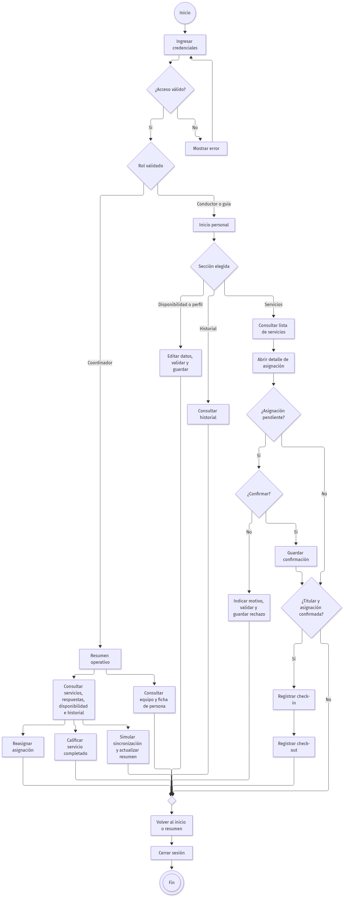

Representación equivalente en Mermaid para visualizarla directamente en GitHub. El archivo editable está en [flujo-usuario.mmd](docs/diseno/flujo-usuario.mmd).

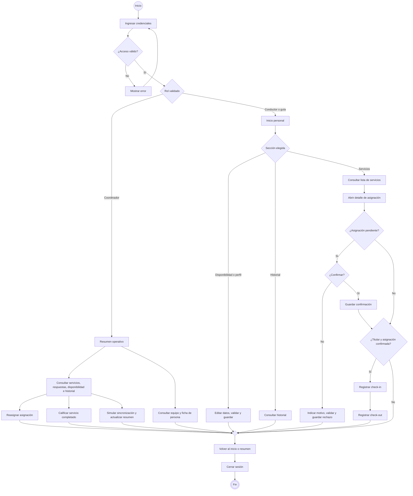

Los errores de formulario se muestran en la misma pantalla. Cada respuesta conserva usuario, fecha y hora. Una asignación rechazada no puede iniciar ejecución; el check-out se habilita después del check-in.

## Pantallas

| Pantalla | Referencia | Elementos principales |
|---|---|---|
| Inicio de sesión | [01-login.png](docs/diseno/interfaces/01-login.png) | Campos de acceso, validación de rol, cuentas de prueba |
| Inicio | [02-inicio.png](docs/diseno/interfaces/02-inicio.png) | Jornada, próximo servicio, servicios de hoy, accesos |
| Servicios | [03-servicios.png](docs/diseno/interfaces/03-servicios.png) | Búsqueda, filtros por estado, tarjetas con chips |
| Detalle | [04-detalle.png](docs/diseno/interfaces/04-detalle.png) | Información, itinerario, reserva, equipo y trazabilidad |
| Disponibilidad | [05-disponibilidad.png](docs/diseno/interfaces/05-disponibilidad.png) | Calendario mensual, `DatePickerDialog`, selección de día, Switch y guardado |
| Perfil | [06-perfil.png](docs/diseno/interfaces/06-perfil.png) | ID de solo lectura, datos editables, idiomas, acumulado |
| Ejecución | [07-ejecucion.png](docs/diseno/interfaces/07-ejecucion.png) | Hitos, check-in con ubicación, check-out |
| Historial | [08-historial.png](docs/diseno/interfaces/08-historial.png) | Filtros, acumulado, trazabilidad y tarifas |
| Resumen de coordinación | [09-resumen-coordinacion.png](docs/diseno/interfaces/09-resumen-coordinacion.png) | Pendientes, confirmadas, rechazadas, recursos y sincronización |
| Equipo | — | Búsqueda por nombre o rol, disponibilidad, idiomas y calificación |
| Ficha de persona | — | Contacto, desempeño, acumulado y servicios activos |

Conductor y guía usan Inicio, Servicios, Agenda y Perfil en la NavigationBar. Historial se abre desde Inicio; detalle desde Servicios; ejecución desde el detalle de un servicio confirmado. Coordinación dispone de su resumen con accesos a todos los servicios, al historial y al equipo.

### Galería

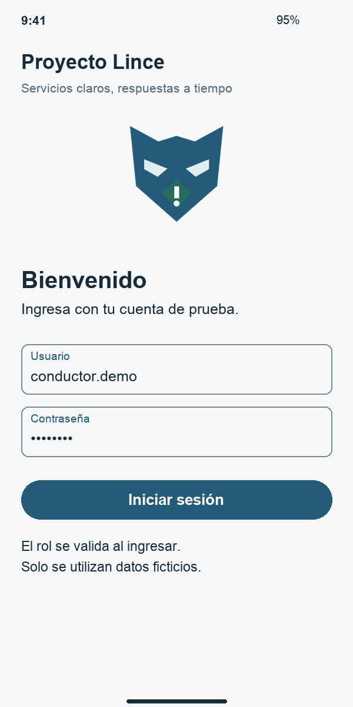

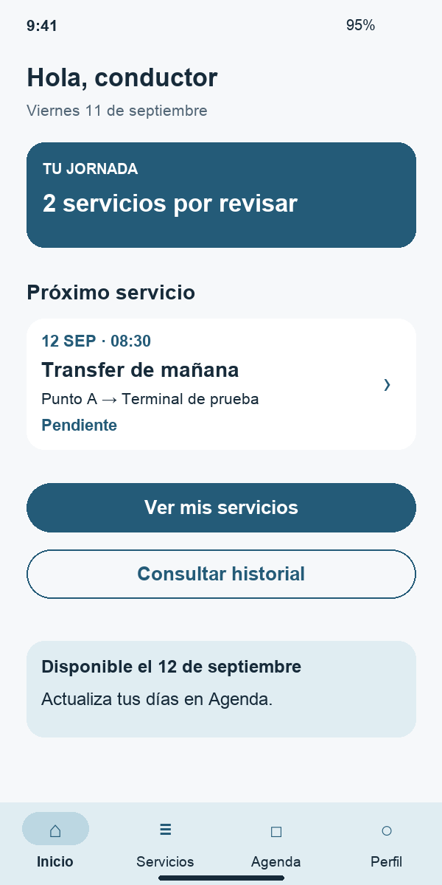

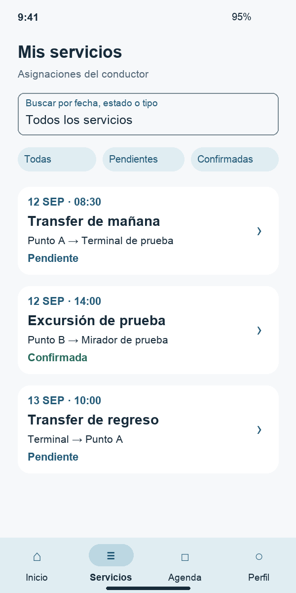

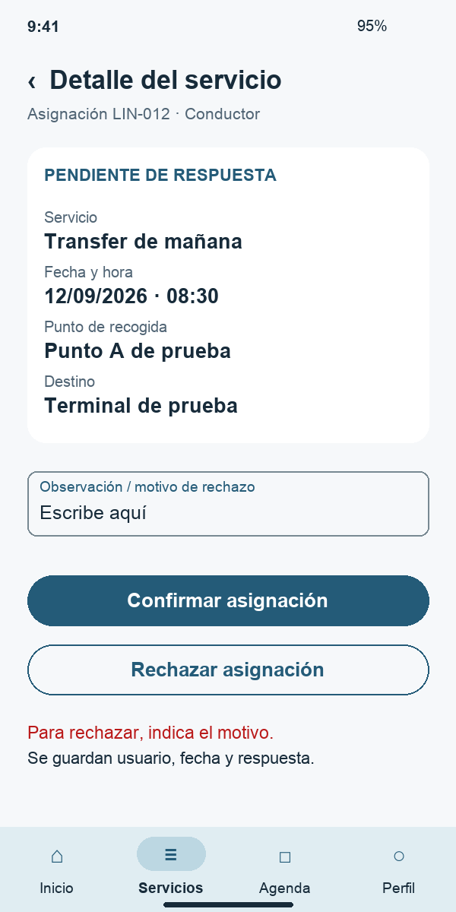

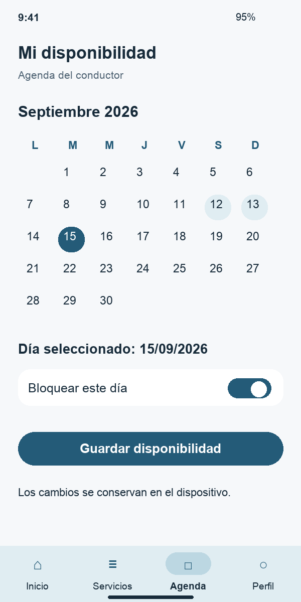

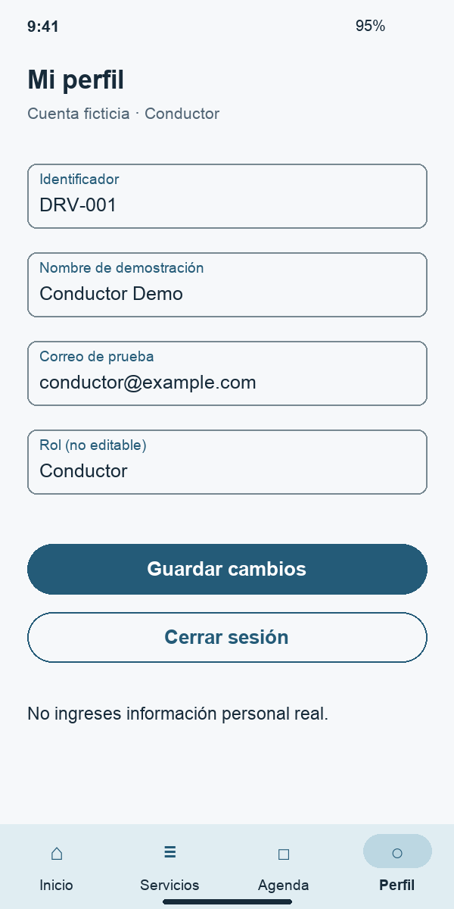

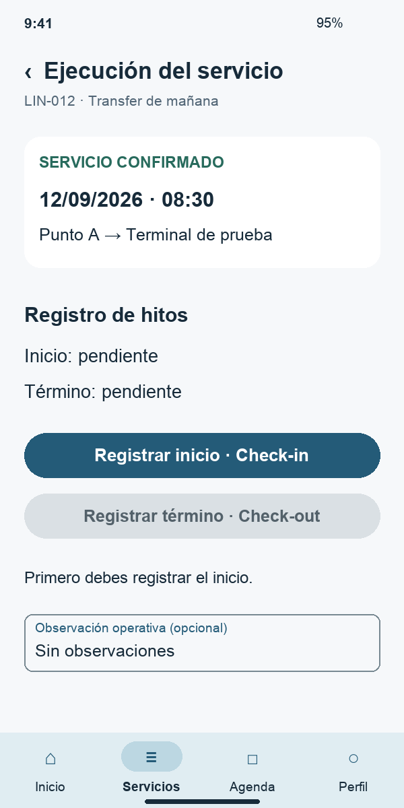

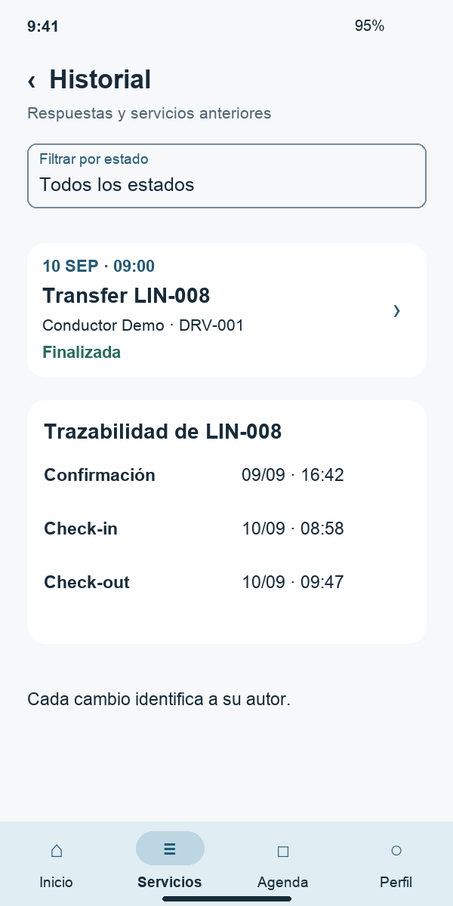

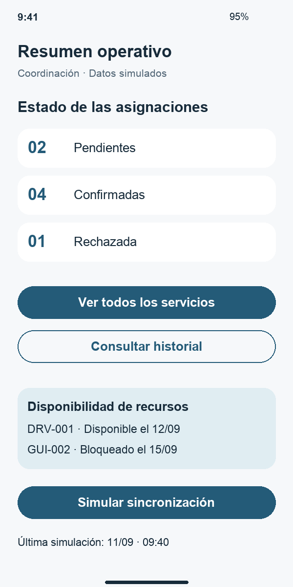

## Tecnologías

- Kotlin y Jetpack Compose con Material 3.
- Arquitectura MVVM: UI, ViewModels y persistencia local en `app/`, reglas de negocio en `dominio/`.
- Persistencia local con Room y Preferences DataStore; estado de la interfaz con `StateFlow`.
- Room 2.7.2 con migraciones, DAOs, cola de operaciones pendientes y pruebas Robolectric. El JSON con `AtomicFile` se conserva solo para importar datos anteriores.
- DataStore para tema, idioma y última sincronización.
- Indicador de conectividad con `ConnectivityManager` y sincronización automática de la cola al recuperar la red.

### Compilar y probar

Android:

```bash
./gradlew :dominio:test
./gradlew :app:testDebugUnitTest
./gradlew :app:lintDebug
./gradlew :app:assembleDebug
```

Backend (requiere `JWT_SECRET`):

```bash
JWT_SECRET=secreto ./gradlew :backend:build
```

Cobertura (Kover):

```bash
./gradlew :app:koverHtmlReport
./gradlew :dominio:koverHtmlReport
```

En Windows:

```bat
gradlew.bat :dominio:test
gradlew.bat :app:testDebugUnitTest
gradlew.bat :app:lintDebug
gradlew.bat :app:assembleDebug
set JWT_SECRET=secreto && gradlew.bat :backend:build
gradlew.bat :app:koverHtmlReport
```

Requiere JDK 17 y Android SDK configurados.

Variables de entorno del backend (`JWT_SECRET` obligatoria; el resto opcionales):

```properties
JWT_SECRET=secreto
PORT=8080
HOST=0.0.0.0
DB_PATH=data/lince.db
DEMO_PASSWORD=Lince123
```

Referencias oficiales de diseño: [Material Design 3](https://m3.material.io/) y [componentes Material para Android](https://developer.android.com/design/ui/mobile/guides/components/material-overview).

## Organización

```text
Proyecto-lince/
├── README.md
├── app/                      # Interfaz, navegación, ViewModels, Room y DataStore
├── dominio/                  # Modelo, repositorios y pruebas
├── backend/                  # API Ktor integrada (autenticación, hitos, disponibilidad, incidencias)
└── docs/
    ├── evidencias/
    │   ├── clase-01/
    │   │   └── Evidencia_Clase_01_MVP_Equipo05.docx
    │   └── clase-02/
    │       └── Evidencia_Clase_02_Diseno_Equipo05.docx
    └── diseno/
        ├── logo.png
        ├── logo.svg
        ├── flujo-usuario-uml.png
        ├── flujo-usuario.mmd
        └── interfaces/
            └── 01-login.png … 09-resumen-coordinacion.png
```

## Entrega de clase 2

- Documento de diseño y recursos visuales incorporados al repositorio.
- Identidad, flujo y pantallas usados como base de la implementación.
- MVP funcional con datos ficticios y persistencia local.
- Persistencia con Room y DataStore, consulta sin Internet y sincronización de registros pendientes al recuperar la conectividad.
- Documentación alineada con la implementación: titular conductor o guía, acompañante opcional, equipo, ficha, reasignación y calificación.
- Pruebas unitarias del dominio, pruebas de persistencia y sincronización, y compilación del APK verificadas.
